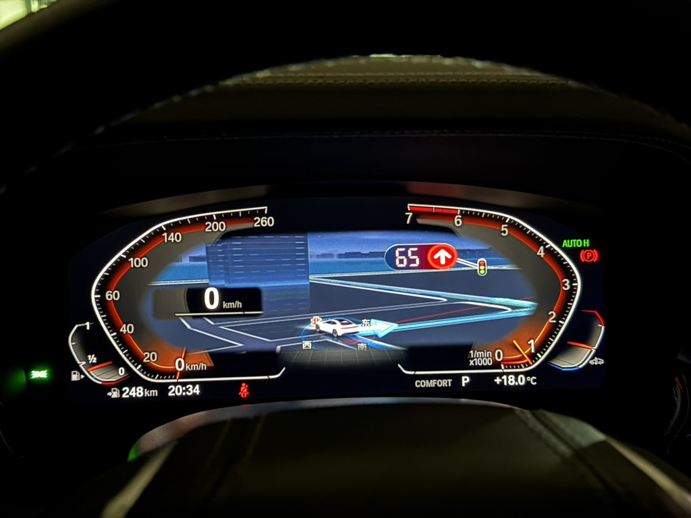

# Cluster fullscreen (iDrive 7)

The Waze app's **Cluster fullscreen** checkbox expands its video onto the
1920×720 panel using a fixed transparent contour. The contour leaves the
original gauge edges and the inner speed readout visible. Unchecking it
returns to the usual map target; if a theme hosts that map, its placement
is restored. HUD settings are independent.

This is opt-in. The checkbox requires an active cluster map and an advertised
`video_gauge_mask_v1` capability. The C++ client holds masked layers and their
frames until the current connection confirms that capability, including
reconnects and downgrades. A shader failure or unsupported renderer does not
fall back to an opaque full-panel video. The service accepts the mask only
on the ID7 1920×720 panel. ID8 is not supported.

The contour is fixed, not a detector for arbitrary gauges, themes, pop-ups or
warning messages. Other vehicle layouts and warning overlays need vehicle
validation; this change does not claim universal cluster compatibility.

## Vehicle evidence

The owner tested the downstream implementation on an iDrive 7 MGU,
firmware `P18_23w44.2-1-3` (`mgu-high`), and reported successful validation.
The owner supplied the photo below for this contribution. It shows the map
expanded around the original gauges while parked. Photo metadata has been
removed without altering decoded pixels. The photo does not prove every
transition, warning layout or firmware variant; the clean upstream PR
branch has not been separately installed on the car.

